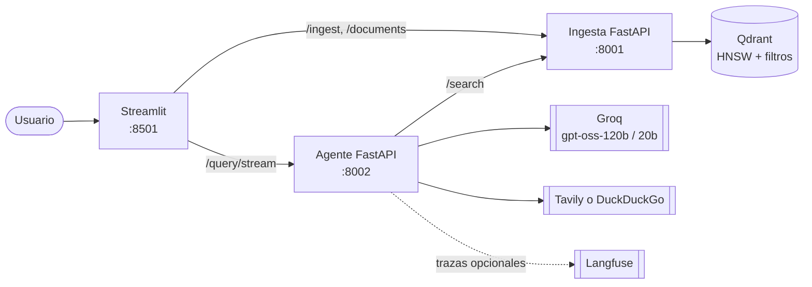
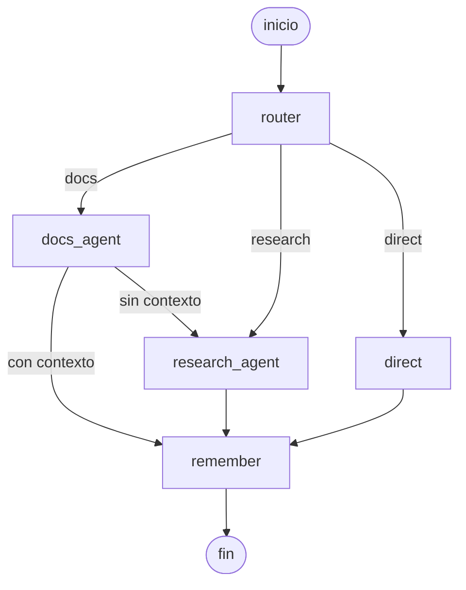
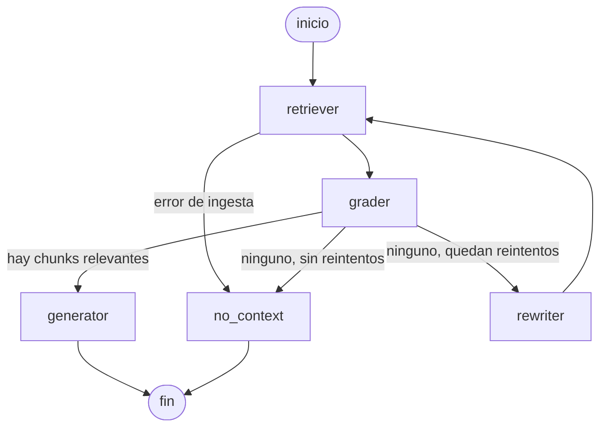
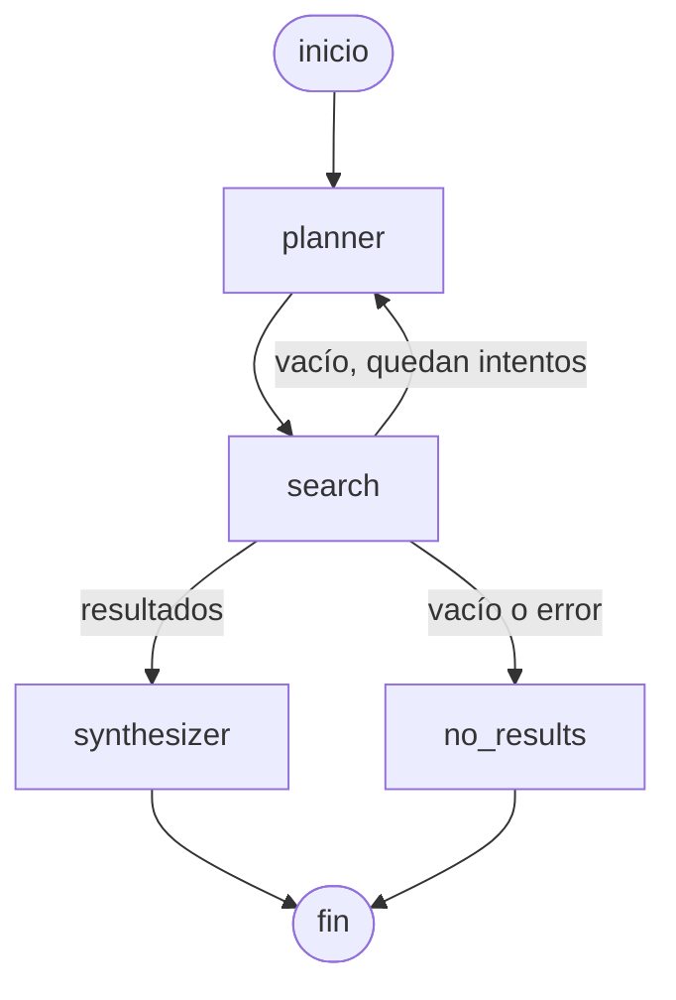

# Asistente de Conocimiento

Asistente agéntico para desarrolladores: un **supervisor LangGraph** decide si una pregunta se responde con la **documentación indexada** (RAG con evaluación y reescritura de consultas), con **investigación web** (herramienta tipada) o directamente, y recuerda la conversación por `thread_id`.

- Subagente de documentación: `retriever → grader → rewriter → generator` con ciclo acotado y citas por fragmento (documento, sección y página).
- Subagente de investigación: `planner → search → synthesizer` con re-planificación acotada y citas con enlace.
- API FastAPI (`/query`, `/query/stream` por SSE), chat en Streamlit, ingesta incremental y Qdrant con índice HNSW y filtros por metadatos.
- Evaluación contra un RAG lineal con LLM-as-judge, precisión del supervisor y análisis de fallos (sección [Evaluación](#evaluación)).

## Arquitectura



El agente sigue una arquitectura por capas, verificada por un test que revisa los imports:

| Capa | Contenido | Puede depender de |
|---|---|---|
| `domain` | modelos, errores y puertos (protocolos) | nada externo |
| `application` | grafos LangGraph de los agentes y del supervisor | `domain` |
| `infrastructure` | Groq, cliente de ingesta, búsqueda web, prompts, configuración | `domain` |
| `api` | FastAPI, esquemas | `application`, `domain` |
| `bootstrap.py` | composición de dependencias | todas |

### Grafos

Supervisor (`python -m app.cli --mermaid supervisor`, desde `services/agent`):



Subagente de documentación (ciclo acotado a 2 reescrituras):



Subagente de investigación (re-planifica una vez si la búsqueda no devuelve nada):



## ¿Por qué agéntico?

Un RAG lineal (`recuperar → generar`) asume que toda pregunta se responde con los documentos y que lo recuperado es útil. Este sistema no lo asume:

1. **Enrutar antes de buscar.** Un saludo o una pregunta sobre "la última versión de X" no deben pasar por el índice. El supervisor las manda a `direct` o `research`; el RAG lineal las responde con fragmentos irrelevantes o inventa.
2. **Verificar lo recuperado.** Los scores de similitud de `e5` se agrupan entre 0.7 y 0.9 incluso para preguntas sin relación (una receta de pizza puntúa 0.83 contra un manual de coche), así que un umbral no sirve. El `grader` (LLM) descarta fragmentos que solo comparten palabras.
3. **Reintentar con otra consulta.** Si ningún fragmento sirve, el `rewriter` reformula la pregunta (en inglés, el idioma de la documentación) hasta 2 veces.
4. **Caer a la web de forma explícita.** Si la documentación no alcanza, el supervisor pasa al subagente de investigación y la respuesta sale marcada como externa, con enlaces.
5. **Decir "no sé".** Si tampoco la web responde, devuelve un mensaje claro en vez de inventar.
6. **Recordar el hilo.** El router reescribe cada pregunta como autónoma ("¿y con Postgres?" se entiende por la conversación).

| Nodo | Problema que resuelve | Consulta donde cambia el resultado | Costo |
|---|---|---|---|
| `router` | Evita pasar por el índice preguntas que no son de documentación | "hola" (c01) o "¿cuál es la última versión de LangGraph?" (r01): el lineal responde con fragmentos irrelevantes o un "no encontré" | 1 llamada a `gpt-oss-20b` por pregunta |
| `retriever` | Recupera con filtros de metadatos (fuente, tipo) sobre el índice HNSW | Con un documento elegido en la interfaz, la búsqueda se restringe a ese archivo y no mezcla otros | Sin LLM; una consulta a Qdrant |
| `grader` | Descarta fragmentos que solo comparten palabras; los scores de `e5` no discriminan | Una receta de pizza puntúa 0.83 contra el manual del coche; el grader la rechaza | 1 llamada a `gpt-oss-20b` por lote de fragmentos |
| `rewriter` | Reformula (en inglés) cuando nada sirvió, hasta 2 veces | Pregunta en español sobre documentación en inglés (d04, d07): puede recuperar lo que la primera consulta no trajo | 1 llamada por reintento más otra recuperación |
| `docs_agent` → `research_agent` | Cae a la web, marcando la respuesta como externa, cuando la documentación no alcanza | Pregunta de documentación que el índice no cubre | Búsqueda web más una síntesis |
| `generator` | Responde solo con el contexto y cita fuentes | Igual que en el RAG lineal; no cambia el resultado | 1 llamada a `gpt-oss-120b` |
| `remember` | Mantiene el hilo por `thread_id` | "¿Y si el subgrafo no comparte claves?" (d05) solo se entiende con la pregunta anterior | Sin LLM extra |

El costo medido es global: en las 12 preguntas de documentación el agéntico gastó unos 3257 tokens por pregunta frente a 1418 del RAG lineal (≈2.3 veces). El gasto por nodo no se midió por separado. Los ejemplos de `router` y `research` son los casos del dataset cuya medición quedó pendiente por la cuota de Groq (ver [Evaluación](#evaluación)).

## Cómo ejecutarlo

Requisitos: Docker (o Python 3.12), y una clave gratuita de [Groq](https://console.groq.com).

### Con Docker Compose

```bash
cp .env.example .env            # completa GROQ_API_KEY (TAVILY_API_KEY es opcional)
docker compose up --build -d
docker compose --profile seed run --rm seed   # descarga e indexa la documentación de LangGraph y requests
```

| Servicio | URL |
|---|---|
| Chat | http://localhost:8501 |
| API del agente (Swagger) | http://localhost:8002/docs |
| API de ingesta (Swagger) | http://localhost:8001/docs |
| Qdrant | http://localhost:6333/dashboard |

La imagen de ingesta incluye el modelo de embeddings (se descarga al construir, sin conexión en ejecución). Si cambias `EMBEDDING_MODEL`, hay que reconstruir la imagen y reingestar todos los documentos: los vectores de dos modelos distintos no son comparables aunque tengan las mismas dimensiones.

### Sin Docker

```bash
docker compose up -d qdrant
python -m venv .venv && .venv/Scripts/activate        # en Linux/macOS: source .venv/bin/activate
pip install -r services/ingestion/requirements.txt -r services/agent/requirements.txt -r frontend/requirements.txt

cd services/ingestion && uvicorn app.main:app --port 8001      # terminal 1
cd services/agent     && uvicorn app.main:app --port 8002      # terminal 2
streamlit run frontend/app.py                                   # terminal 3
python scripts/load_dataset.py                                  # carga el dataset
```

## Uso

**Chat:** sube documentos desde la barra lateral, filtra por documento, y debajo de cada respuesta ves el agente que respondió, las fuentes citadas y la trazabilidad (nodo, ms, tokens).

**API:**

```bash
curl -X POST http://localhost:8002/query -H "Content-Type: application/json" \
  -d '{"question": "¿Cómo se agrega un subgrafo como nodo de un grafo padre?", "thread_id": "demo"}'
```

La respuesta incluye `answer`, `agent`, `route`, `external`, `citations`, `nodes_traversed`, `steps`, `total_ms` y `total_tokens`. Con el mismo `thread_id` el supervisor conserva el contexto; `sources` limita la búsqueda a ciertos documentos.

**Streaming (SSE):** `POST /query/stream` emite un evento `step` por cada nodo apenas termina y un evento final `answer` (o `error`). El efecto de escritura del chat es solo visual, en el cliente: la respuesta llega completa del servidor.

**CLI:** `python -m app.cli "pregunta"` o `--chat`, desde `services/agent`.

**Ingesta incremental:** `POST /ingest` calcula el hash del contenido y responde `created`, `updated` (cambió el contenido), `unchanged` (no recalcula embeddings) o `duplicate` (mismo contenido con otro nombre).

## Decisiones de diseño

| Decisión | Por qué | Descartado |
|---|---|---|
| Supervisor con tres rutas y fallback docs → web | Cada pregunta paga solo lo que necesita; la web es el último recurso, no el primero | Un único agente con herramientas: menos predecible y más difícil de evaluar |
| Embeddings `multilingual-e5-small` | Las preguntas llegan en español y la documentación está en inglés | `bge-small-en`: solo inglés, malos resultados con consultas en español |
| Chunking por encabezados (1000 caracteres, solape de 150) | Cada fragmento conserva su sección y la cita es precisa | Ventanas fijas: cortan ideas y pierden la sección |
| Qdrant con HNSW (`m=16`, `ef_construct=128`) y filtros por `source` y `doc_type` | Buen recall con poca memoria y filtrado por documento sin recorrer todo | Búsqueda exacta: no escala |
| `grader` con LLM en lugar de umbral de score | Los scores de `e5` son poco discriminantes (ver arriba) | Umbral fijo |
| Salida estructurada con `json_schema` | El modo de llamada a herramientas de Groq fallaba de forma intermitente con el router | `tool_calling` |
| Herramienta web tipada (`WebSearchRequest`) con Tavily o DuckDuckGo | Entrada validada; funciona sin clave (DuckDuckGo) y mejora con Tavily | Pasar texto libre al buscador |
| Contenido web tratado como no confiable | Los resultados no pueden dar instrucciones al sintetizador | Confiar en el texto de la web |
| Prompts en español | Los usuarios escriben en español | Prompts en inglés |
| Arquitectura por capas con test de imports | El dominio no depende del framework; se puede cambiar Groq o LangGraph sin tocarlo | Un solo módulo |

## Evaluación

**Método.** [eval/dataset.json](eval/dataset.json) tiene 21 preguntas con ruta esperada, fuentes esperadas y una referencia: 13 sobre documentación (incluye una pregunta de seguimiento dentro del mismo hilo y una en inglés), 4 que requieren la web y 4 de charla directa. [eval/run_eval.py](eval/run_eval.py) las ejecuta contra dos sistemas con el mismo generador y el mismo `top_k`:

- **Agéntico:** el supervisor completo.
- **RAG lineal:** `recuperar → generar`, sin enrutar, sin grader, sin reescritura y sin web.

Métricas: precisión del supervisor (ruta elegida contra esperada), fuente correcta citada, y un **LLM-as-judge** (`gpt-oss-120b`) que compara cada respuesta con su referencia y devuelve puntaje 1-5, correcta sí/no y alucinación sí/no. Además mide latencia y tokens. Se usa un juez propio en lugar de Ragas porque cada pregunta tiene una referencia escrita a mano, lo que evita añadir una dependencia pesada para métricas que aquí se resuelven con un prompt.

```bash
python eval/run_eval.py            # con ingesta y claves configuradas; escribe eval/report.md y eval/results.json
python eval/run_eval.py --resume   # continúa si Groq cortó por límite de cuota
python eval/run_eval.py --routing-only   # solo la precisión del supervisor, con el modelo pequeño
```

El script guarda el progreso después de cada pregunta y se detiene, sin falsear resultados, si Groq devuelve 429 o si el router falla (un fallo del router cae a `docs` por diseño, y eso contaminaría la precisión del supervisor).

**Resultados (parciales).** La corrida completó las **12 primeras preguntas de documentación** (d01 a d12); se cortó en d13 porque `gpt-oss-120b` agotó su cuota diaria del plan gratuito (200.000 tokens). La **calidad de las respuestas** de investigación (r01-r04) y de charla directa (c01-c04) **no se ha medido en una corrida limpia**; lo que sí se midió de esas categorías es la ruta que elige el supervisor (ver más abajo). Detalle completo en [eval/report.md](eval/report.md).

| Sistema | N | Correctas | Puntaje (1-5) | Alucinación | Fuente correcta | Latencia media | Tokens medios |
|---|---|---|---|---|---|---|---|
| Agéntico | 12 | 83% | 4.67 | 0% | 92% | 7.0 s | 3257 |
| RAG lineal | 12 | 92% | 4.67 | 0% | 92% | 8.8 s | 1418 |

**Precisión del supervisor: 21/21 (100%).** Se midió con `python eval/run_eval.py --routing-only`, que llama solo al router (`gpt-oss-20b`) con las 21 preguntas y compara la ruta elegida con la esperada: 13 de `docs`, 4 de `research` y 4 de `direct`. En la corrida de calidad, ninguna de las 12 preguntas de documentación pasó a la web por falta de contexto.

Esta cifra mide solo el enrutamiento, no la calidad de lo que responde cada agente después. Además, la pregunta de seguimiento d05 se enruta con la pregunta anterior y su referencia como historial, no con la respuesta real del asistente, y 21 preguntas con rutas bien separadas son una prueba favorable al router: no incluye casos ambiguos.

Lectura honesta:

- En documentación el agente **no mejora** al RAG lineal: el puntaje medio es idéntico (4.67) y el lineal acertó una pregunta más (d07). Con 12 preguntas esa diferencia es una sola respuesta y no es concluyente.
- **Costo:** el agéntico gasta unos 3257 tokens por pregunta frente a 1418 del lineal (≈2.3 veces), por las llamadas del router y del grader. La latencia media no empeoró (7.0 s contra 8.8 s), pero depende mucho de la carga de Groq y no debe leerse como ventaja.
- El valor del agente está en lo que esta corrida **no pudo medir todavía**: no pasar por el índice en charla directa y buscar en la web cuando la documentación no alcanza. Esas dos categorías están en el dataset y el script las evalúa; falta ejecutarlas con cuota disponible (`python eval/run_eval.py --resume`).

**Análisis de fallos** (casos fallidos de la corrida parcial y de pruebas manuales):

1. **Respuesta incompleta por recuperación (d04, "¿cómo se agrega un subgrafo como nodo?").** La referencia tiene dos casos: estados compartidos y estados distintos. Ambos sistemas responden solo el primero. Causa, comprobada contra el índice: con la pregunta en español, los 6 fragmentos recuperados incluyen tres de la sección "Add a subgraph as a node" y ninguno de "Call a subgraph inside a node", que es donde está el segundo caso; con la consulta en inglés esa sección sí entra (sexta posición). El grader no puede recuperar lo que el retriever no trajo. Mitigación posible: traducir la consulta al inglés antes de buscar, o añadir reranking (reto B, no implementado).
2. **Fragmento tangencial que evita la reescritura (d07, "¿cómo se pausa un grafo para aprobación humana?").** Responde citando `langgraph-thinking-in-langgraph.md` y omite `Command(resume=...)`. Causa, comprobada contra el índice: con la pregunta en español, 5 de los 6 primeros fragmentos son ruido (el PDF de requests y el manual del coche, con scores de 0.82-0.83) y `langgraph-interrupts.md` no aparece; con la consulta en inglés ocupa el primer lugar. El grader acepta como relevante el único fragmento que sí menciona pausas, así que no se dispara la reescritura (en inglés) que habría encontrado el documento correcto. El problema de fondo es la recuperación entre idiomas: preguntar en español sobre documentación en inglés con un modelo pequeño deja un ranking débil, y el grader mide si un fragmento "ayuda", no si es el canónico.
3. **Ruta equivocada del router (encontrado en pruebas manuales).** Con 41 archivos de LangGraph y un único PDF ("manual carro.pdf"), el router mandaba una pregunta sobre el coche a `research` o a `direct`: razonaba por los nombres de archivo y concluía que el tema "no estaba". Se corrigió haciendo que `docs` sea la ruta por defecto y que el fallback a la web lo decida la búsqueda, no el router. Sigue siendo un riesgo para preguntas ambiguas del tipo "novedades de X", que se resuelven bien solo si el prompt las nombra explícitamente como recientes.
4. **Fallo silencioso del router (descubierto al evaluar).** Si Groq falla, el router cae a `docs` y la respuesta parece normal. Con el límite diario del plan gratuito agotado, eso hacía que preguntas de investigación y de charla "fueran" a documentación. La traza lo registra (`router falló, ruta por defecto docs`) y la evaluación lo detecta y se detiene, pero para el usuario final sería preferible avisar.

**Límites de esta evaluación.** El juez es un LLM y puede ser estricto o laxo (se corrigieron dos fallos del propio arnés: el juez no veía las URLs de las citas y una referencia incompleta); 21 preguntas dan una idea del comportamiento, no una estimación estadística; la latencia depende mucho de la carga de Groq y no debe leerse como comparación fina; y el plan gratuito de Groq (200.000 tokens por día y por modelo) limita cuántas corridas completas caben en un día.

## Retos opcionales implementados

- **F · Ingesta incremental:** hash de contenido; no reindexa documentos sin cambios ni duplica contenido idéntico.
- **C · Streaming por SSE:** `/query/stream` con pasos en vivo y el chat los muestra mientras ocurren.
- **E · Observabilidad con Langfuse:** con `LANGFUSE_PUBLIC_KEY` y `LANGFUSE_SECRET_KEY` cada consulta genera una traza con sus nodos, latencia y tokens, agrupada por `thread_id` como sesión. Sin claves queda desactivado. Está cubierto por tests con un manejador de prueba, pero no lo he verificado contra una cuenta real de Langfuse.

No implementados: A (servidor MCP), B (búsqueda híbrida y reranking) y D (confirmación humana antes de la búsqueda externa).

## Estructura

```
services/ingestion   ingesta, chunking, embeddings y Qdrant
services/agent       supervisor, subagentes y API de consulta (por capas)
frontend             chat en Streamlit
eval                 dataset, script de evaluación e informe
scripts              descarga e indexación del dataset
docker-compose.yml   qdrant, ingesta, agente, frontend (y seed opcional)
```

## Pruebas

```bash
pip install pytest
cd services/agent     && python -m pytest
cd services/ingestion && python -m pytest
```

## Limitaciones

- Los scores de similitud no sirven como umbral de relevancia; se confía en el `grader`, que añade una llamada al LLM por ronda.
- La memoria de conversación está en proceso (`MemorySaver`): se pierde al reiniciar el agente.
- La web depende de DuckDuckGo (con límites de uso) si no hay clave de Tavily.
- El efecto de escritura del chat es visual; el servidor no transmite token a token.
